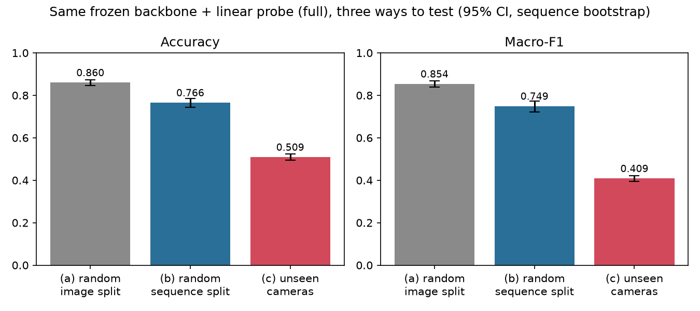
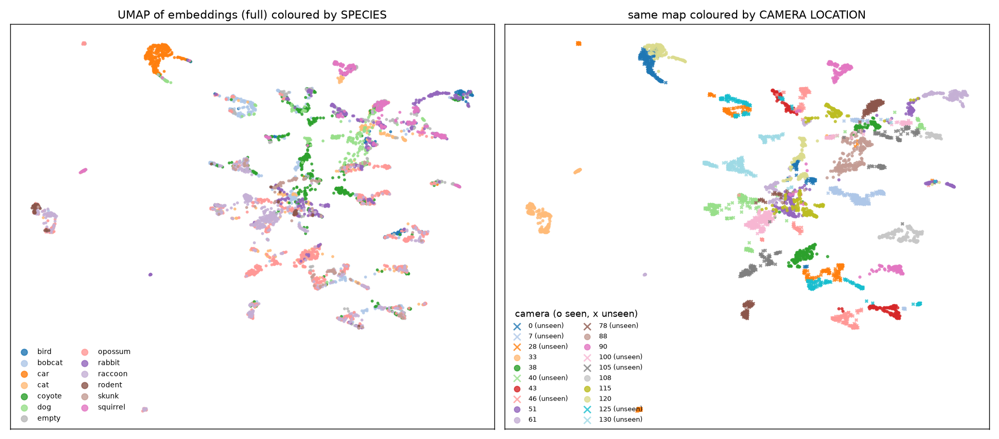
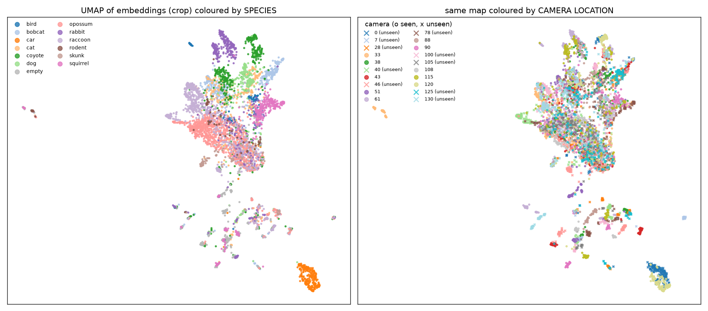
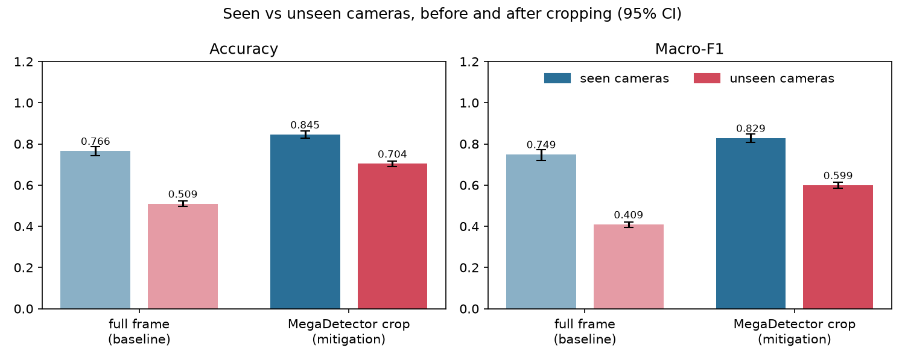

# Do camera-trap species classifiers survive a new camera?

Camera traps are motion-triggered cameras that conservation teams leave in the field for months, producing far more images than people can label. A species classifier trained on the cameras you have labelled is only useful if it also works on the cameras you have not. This project measures how badly a strong, general-purpose classifier (frozen DINOv2-small features + a linear classifier) degrades at camera locations it has never seen, on the Caltech Camera Traps benchmark (CCT20) from LILA BC; shows where the gap comes from (the camera, and the burst structure of camera-trap data, quietly leak into the score); and tests one fix: cropping the animal out with MegaDetector detections before classifying. Everything runs on a CPU laptop within a 6 GB budget.

## Results

Same frozen backbone and linear probe every time. Only the test set (and, for the right-hand columns, the input crop) changes. 95% confidence intervals come from a bootstrap that resamples whole bursts of frames, because the frames of one burst are near-copies.

<!-- RESULTS_TABLE:START -->
| Split | Accuracy, baseline | Macro-F1, baseline | Accuracy, MegaDetector crop | Macro-F1, MegaDetector crop |
|---|---|---|---|---|
| (a) random image split (seen cameras) | 0.860 [0.847, 0.873] | 0.854 [0.838, 0.868] | 0.876 [0.864, 0.889] | 0.867 [0.851, 0.881] |
| (b) random sequence split (seen cameras) | 0.766 [0.744, 0.786] | 0.749 [0.721, 0.774] | 0.845 [0.828, 0.861] | 0.829 [0.806, 0.847] |
| (c) held-out cameras (CCT20 trans_test) | 0.509 [0.496, 0.523] | 0.409 [0.396, 0.422] | 0.704 [0.692, 0.715] | 0.599 [0.583, 0.613] |
| **Gap (b) minus (c): the camera-shift penalty** | +0.256 [+0.230, +0.281] | +0.341 [+0.310, +0.367] | +0.142 [+0.120, +0.162] | +0.229 [+0.201, +0.253] |
| **Gap (a) minus (c): leakage + camera shift** | +0.351 [+0.333, +0.370] | +0.445 [+0.426, +0.465] | +0.173 [+0.155, +0.190] | +0.267 [+0.246, +0.288] |

Paired change from cropping (crop minus baseline), 95% CI from the same bootstrap resamples:

| Quantity | Accuracy | Macro-F1 |
|---|---|---|
| Unseen-camera score | +0.194 [+0.181, +0.207] | +0.191 [+0.175, +0.205] |
| Seen-camera score | +0.080 [+0.060, +0.100] | +0.079 [+0.056, +0.106] |
| Seen-minus-unseen gap | -0.115 [-0.138, -0.091] | -0.111 [-0.138, -0.081] |

Control: is it the background, or the zoom? (paired 95% CI; same frozen backbone and probe)

| Input to the model | Unseen-camera accuracy | Unseen-camera macro-F1 | Seen-minus-unseen accuracy gap |
|---|---|---|---|
| whole frame (baseline) | 0.509 [0.496, 0.523] | 0.409 [0.395, 0.421] | 0.256 [0.231, 0.281] |
| whole frame, background greyed out (same resolution) | 0.536 [0.524, 0.549] | 0.431 [0.418, 0.442] | 0.208 [0.185, 0.231] |
| MegaDetector crop | 0.704 [0.692, 0.715] | 0.599 [0.584, 0.613] | 0.142 [0.120, 0.163] |

Test sizes: (a) 3298 images, (b) 3332 images, (c) 11616 images in 4488 bursts. CIs: cluster (sequence) bootstrap, percentile 95%, 2000 resamples.
<!-- RESULTS_TABLE:END -->

Every number in this README is read from a file in `results/` written by a script.

## Key figures

**A random image split flatters the model; a new camera exposes it** (`figures/p5_split_comparison_full.png`)



**The embedding groups frames by camera, not by species** (left: species, right: camera; `figures/p4_umap_full.png`)



**After cropping the animal, species clusters dominate and cameras mix** (`figures/p4_umap_crop.png`)



**Cropping lifts unseen-camera scores and shrinks, but does not close, the gap** (`figures/p6_gap_before_after.png`)



More: `figures/p1_location_grid.png` (backgrounds differ), `p3_preprocessing.png` (what each preprocessing step does), `p5_confusion_full.png`, `p5_failure_gallery_worst.png`, `p5_failure_categories.png`, `p6_class_change.png`.

## What I learned

1. **Split by burst.** About 82.5% of the images in a random image split's test set have a near-identical burst-mate in the training set (`results/phase2_splits.json`). Scoring under that split inflates accuracy by roughly ten points compared with a split that keeps bursts together. Anything that can memorise gets rewarded.
2. **A new camera costs far more than that.** On unseen cameras, accuracy and especially macro-F1 fall sharply and rare classes collapse. The loss is spread unevenly: per-camera accuracy on the unseen cameras ranges widely, so an average hides near-useless cameras.
3. **The camera is easy to read from the embedding.** A linear probe names the camera from a frame's embedding almost perfectly, even on empty frames with no animal in them, and each camera has its own mix of species. The model had a background shortcut available, and the failure gallery looks like one being used (the same sunlit scene confidently labelled "squirrel").
4. **Not every failure is a hard image.** Night/IR frames and blurry frames are not noticeably more error-prone than others; animals the detector could not find, or that are tiny, are.
5. **Cropping helps a lot, and the reason is not what I expected.** The crop closed roughly half of the gap and also improved seen cameras. A control that greys out the background but keeps the animal small recovers only a small part of the benefit: most of it comes from giving the animal many more pixels, not from removing the background as such.
6. **Check your evaluation before your model.** The official CCT20 training file has no empty frames, and some bursts appear in more than one official file; both would have quietly biased a naive evaluation.

## Video test (preliminary)

Does the crop model still work on real trail-camera **video** from cameras and places it has never seen? The video stage runs the same pipeline as the Phase 6 crop model on public video clips:

```
video -> sample 1 frame per second -> MegaDetector v6 (MDV6-apa-rtdetr-c, boxes with conf >= 0.2)
      -> highest-confidence box + 10% margin, padded to 224x224 -> DINOv2-small -> the same linear probe
      -> drop frames whose crop the probe calls "empty" (a false detection)
      -> average the class probabilities over the remaining frames = one answer per clip (one visit)
```

The probe is the Phase 4 crop probe ("b"), exported to [models/probe_b_crop.npz](models/probe_b_crop.npz) as plain arrays. The export checks that it reproduces the saved Phase 4 probabilities (max difference about 1e-6).

**Detector.** The video stage uses MegaDetector v6 in its Apache-2.0 RT-DETR variant. The classifier was trained on boxes from MegaDetector v5a, but v5a's weight licence is unclear and its inference code is GPL-3.0, which rules it out for a public demo. MDv6 runs about 7× faster on CPU (0.2 s against 1.4 s per frame). On frames with an animal the two detectors give nearly the same boxes and confidences. Unlike v5a, MDv6 also boxes title cards and logos in edited clips, so the vote drops frames whose crop the probe calls "empty". That rule was added after seeing this failure, and it leaves the v5a result unchanged. Both detectors are scored on the same clips below. v5a can still be run with `CAMERATRAP_DETECTOR=mdv5a` after `pip install megadetector`. Each clip is put in one of three tiers: **tier 1**, a training species on a new camera; **tier 2**, a related species that maps to a training class (a toucan is a "bird", an Australian wild dog is a "dog"); **tier 3**, a species outside the 13 classes (bear, wolf, mountain lion, badger), where the model must still pick one of its classes. For tier 3 we record whether that forced answer is a sensible relative and whether confidence is low enough for a cut-off to say "not sure".

<!-- VIDEO_TABLE:START -->
Video test, 23 clips from 13 sites, one visit per clip, 1 frame/s, detector mdv6 (`results/video_eval_1fps_mdv6.json`). Accuracy with 95% site-cluster bootstrap intervals.

| Clips | n | Accuracy [95% CI] |
|---|---|---|
| Known species, all (tier 1 + 2) | 16 | 0.69 [0.38, 0.87] |
| Tier 1: training species, new camera | 11 | 0.64 [0.17, 0.86] |
| Tier 2: related species mapped to a class | 5 | 0.80 [0.57, 1.00] |
| Known species, low risk of sharing the training camera network | 12 | 0.67 [0.38, 0.86] |
| Known species, all, with the legacy MegaDetector v5a (the detector behind the training crops) | 16 | 0.88 [0.71, 1.00] |

Unknown species (tier 3, n = 7): the forced answer was a sensible relative in 0.71 [0.40, 1.00] of clips; median confidence 0.52 (known species: 0.80 when right, 0.33 when wrong).

| Confidence cut-off | Known, correct, flagged | Known, wrong, flagged | Unknown species flagged |
|---|---|---|---|
| < 0.3 | 0% | 40% | 14% |
| < 0.4 | 9% | 100% | 29% |
| < 0.5 | 18% | 100% | 43% |
| < 0.6 | 27% | 100% | 71% |
| < 0.7 | 45% | 100% | 71% |
| < 0.8 | 55% | 100% | 100% |
<!-- VIDEO_TABLE:END -->

How to read this:
- **The sample is small.** With 23 clips the intervals are wide, and a perfect score on a handful of clips gives a degenerate interval ([1.00, 1.00] means "too few clips to show any spread", not "certain"). Six raccoon clips come from two sites. Read these numbers as a sanity check that the pipeline works on video, not as a measured accuracy comparable to the image results above.
- **Overlap with the training cameras.** CCT images were collected by the NPS (Santa Monica Mountains) and the USGS in southern California. No test video is in CCT, which contains only stills, but clips from those programmes could come from cameras the model has seen. Each clip carries a `cct_overlap_risk` flag (high: Santa Monica Mountains NPS; medium: other USGS southern-California footage; low: anywhere else), and the table reports the low-risk subset separately.
- **Confidence helps, but not enough.** Wrong answers on known species had low confidence, but close relatives of a training class (wolf → dog, mountain lion → bobcat, badger → skunk) were often answered confidently. A plain cut-off cannot catch those.
- **MDv6 against v5a.** The gap between the two detectors comes from three borderline clips (a bobcat, a toucan, a coyote) that both detectors answered with low confidence (about 0.2 to 0.36); with MDv6 they tip to the wrong class. The intervals overlap heavily. A plausible cause is that the probe learned from v5a-style boxes; refitting the probe on MDv6 crops of the training images would test this. The detector threshold was not tuned on these clips.
- **Missing classes.** No openly licensed clips were found yet for opossum, rabbit, rodent, cat, car or empty.

Every clip is public domain or Creative Commons. Sources, authors, licences and checksums are in [results/video_clips.csv](results/video_clips.csv). The videos themselves are not in this repo.

**Try it in your browser:** [live demo on the project page](https://ray021207.github.io/portfolio_v2/projects/camera-trap-location-shift.html). Both models run inside the browser through onnxruntime-web (`web/`, built by `scripts/export_onnx.py` and `scripts/build_web_demo.py`; model files on [Hugging Face](https://huggingface.co/ray0987/camera-trap-demo-models)). Run through the same ONNX files, the 23 test clips give the same verdict as the PyTorch pipeline on every clip (`results/video_eval_1fps_mdv6onnx.json`).

**Try it on your own video.** `python scripts/demo_app.py` opens the demo locally: pick an example or upload a clip, and get it back with a box, species and confidence on each analysed frame, plus the per-clip answer. The same app (`space/app.py`) is built for Hugging Face Spaces with `python scripts/build_space.py`. `python scripts/15_video_predict.py --source 0 --show` runs live from a webcam.

## Limitations

- One backbone (DINOv2-small), one classifier (linear probe), one seed. The conclusions are about this setup.
- **MegaDetector was not run by me for the image results.** I used the detections LILA published for this dataset (MDv5a), joined by file name; I did not verify them against a local run, and I did not check whether MegaDetector's own training data overlapped these cameras. (The video test runs MegaDetector v6 locally; v5a was run locally only for the side-by-side comparison. See [LICENSES_AND_ATTRIBUTION.md](LICENSES_AND_ATTRIBUTION.md).)
- The headline unseen-camera test covers nine cameras (CCT20 `trans_test`; the tenth unseen camera is reported separately), a small sample of "new cameras"; the gap varies a lot between them.
- A 50% sample of bursts was used (storage and CPU time), and the benchmark has far fewer empty frames than the full dataset.
- The seen-camera test still leaks lighting and scene context (test bursts are usually close in time to training bursts at the same camera), so the true seen/unseen gap is somewhat smaller than the (b)-(c) difference shows.
- Failure categories are rule-based heuristics, checked visually but not hand-labelled.
- The control for "background vs magnification" greys out a large area, which is itself unnatural for a network trained on photos, so it may understate the background effect.
- The timestamp banner printed on each frame is left in and might identify the camera.

## What I would do next

1. Fine-tune end-to-end on a GPU, and compare with camera-invariance training (augmentation that mixes backgrounds, domain-adversarial or invariant-risk objectives).
2. Run MegaDetector v6 locally on the full-resolution training frames, refit the probe on those crops (so detector and classifier match), tune the threshold on validation data, and use all boxes rather than the top one.
3. Leave-one-camera-out evaluation for tighter estimates of the new-camera gap; add a second backbone (supervised ResNet-50, CLIP) and several seeds.
4. Test-time adaptation using a new camera's unlabelled images, and calibrated abstention ("send to a human") for low-confidence frames.
5. Mask the timestamp banner and see whether the seen-camera score moves.
6. Grow the video test to 60–80 clips with one or two clips per camera, fill the missing classes (opossum, rabbit, rodent, cat, car, empty).

## Dataset
Caltech Camera Traps, "CCT20" ECCV-2018 benchmark split (Beery, Van Horn, Perona, *Recognition in Terra Incognita*, ECCV 2018), hosted by LILA BC: https://lila.science/datasets/caltech-camera-traps. The benchmark split has 57,864 images from 20 camera locations (10 "cis"/seen, 10 "trans"/unseen); the full dataset has 243,100 images.
- Split metadata: https://storage.googleapis.com/public-datasets-lila/caltechcameratraps/eccv_18_annotations.tar.gz
- Images (sampled, fetched by URL): https://storage.googleapis.com/public-datasets-lila/caltech-unzipped/cct_images/FILE_NAME
- Precomputed MegaDetector v5a results (RDE-filtered), published by LILA: https://lila.science/public/lila-md-results/caltech-camera-traps_mdv5a.0.0_results.filtered_rde_0.150_0.850_10_0.300.json.zip
- Pretrained backbone: `facebook/dinov2-small` (Oquab et al., DINOv2, arXiv:2304.07193).
- Version string inside the files: "Caltech Camera Traps - ECCV18". Files fetched 2026-11-19.
- Used here: a seeded 50% sample of bursts (28,943 images, 2.17 GB after shrinking to max side 640 px). Details: `results/phase1_sampling.json`.

**Licence and citation.** The data are released under the Community Data License Agreement, Permissive, Version 1.0 (CDLA-Permissive-1.0; text in `licenses/CDLA-Permissive-1.0.md`). Please cite: Sara Beery, Grant Van Horn, Pietro Perona. *Recognition in Terra Incognita.* ECCV 2018. Images are credited to the NPS/USGS and the rights holders named in the metadata. The raw images are not in this repo; figures contain modified excerpts under the same terms. All licences, attribution, and what is and is not redistributed (including an open question about the MegaDetector v5a weights; the video stage uses the Apache-2.0 MegaDetector v6 instead): [LICENSES_AND_ATTRIBUTION.md](LICENSES_AND_ATTRIBUTION.md); packages: [THIRD_PARTY_LICENSES.md](THIRD_PARTY_LICENSES.md). No licence has been chosen yet for this repository's own code.

## Reproduce
Windows, Python 3.12, CPU only. Run from the repo root, in this order. `data/` is not in git. Total compute is a few hours on 8 cores, mostly the three embedding passes.
```
uv venv --python 3.12 .venv ; .venv\Scripts\activate
uv pip install -r requirements.txt
# one-off metadata (into data/meta and data/md):
#   curl -O https://storage.googleapis.com/public-datasets-lila/caltechcameratraps/eccv_18_annotations.tar.gz   -> extract in data/meta
#   MegaDetector json zip (URL in "Dataset" above)                                                              -> unzip in data/md
python scripts/00_env_check.py              # phase 0: machine + budget
python scripts/01_build_metadata.py         # phase 1: merge annotation files, draw the burst-level sample
python scripts/02_download.py               # phase 1: download + shrink the sampled images (~15 min)
python scripts/03_audit.py                  # phase 1: audit, figures, per-image IR/sharpness stats
python scripts/03b_full_cct_context.py      # phase 1: empty share of the FULL dataset (metadata only)
python scripts/04_splits.py                 # phase 2: random-image / random-sequence / held-out-camera splits + leakage measurement
python scripts/05_preprocess_figure.py      # phase 3: preprocessing figures + normalisation statistics
python scripts/06_extract_embeddings.py --mode full   # phase 4: frozen DINOv2-small embeddings (~26 min on CPU)
python scripts/07_train_probe.py --feature full       # phase 4: linear probes for splits a, b, official
python scripts/08_umap.py --feature full              # phase 4: UMAP + camera-decodability numbers
python scripts/09_evaluate.py --feature full          # phase 5: metrics, bootstrap CIs, confusion matrices
python scripts/10_failure_gallery.py                  # phase 5: failure gallery + error categories
python scripts/06_extract_embeddings.py --mode crop   # phase 6: embeddings of MegaDetector crops (~19 min)
python scripts/07_train_probe.py --feature crop
python scripts/08_umap.py --feature crop
python scripts/09_evaluate.py --feature crop
python scripts/11_mitigation_compare.py               # phase 6: paired comparison crop vs full
python scripts/06_extract_embeddings.py --mode mask   # phase 6 control: grey out background, keep resolution (~26 min)
python scripts/07_train_probe.py --feature mask
python scripts/08_umap.py --feature mask
python scripts/09_evaluate.py --feature mask
python scripts/11b_control_mask.py                    # phase 6 control: background removal vs magnification
python scripts/13_collect_licenses.py                 # licences of all pinned packages -> THIRD_PARTY_LICENSES.md (per-package licence files go to licenses/third_party/, not committed)
python scripts/12_make_tables.py                      # phase 7: fills the results table above from results/*.json
# video stage (MegaDetector v6 weights, 322 MB, download from Zenodo on first run; the probe is models/probe_b_crop.npz)
python scripts/video_add_clips.py batch.json          # download + log test clips (fields: see the script; sources in results/video_clips.csv)
python scripts/15_video_predict.py                    # run the pipeline on every logged clip (~1.4 s per frame on CPU)
python scripts/16_video_evaluate.py                   # per-visit accuracy with site-cluster bootstrap CIs; fills the video table above
python scripts/build_space.py                         # optional: assemble the web demo (app, probe, MDv6 weights, example results) in build/space/
python scripts/demo_app.py                            # optional: run the web demo locally (http://127.0.0.1:7860)
python scripts/export_onnx.py                         # optional: ONNX export for the in-browser demo (+ checks against PyTorch)
python scripts/build_web_demo.py                      # optional: model files, config and example results for the in-browser demo, in build/web/
```
